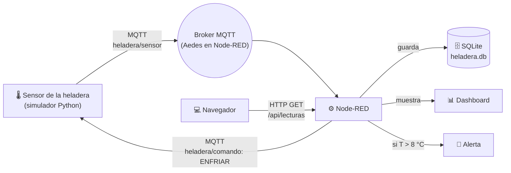

# 🌡️ Monitor Inteligente de Temperatura para Heladeras

**Trabajo Final – Internet de las Cosas (IoT)**

**Alumna:** Luciana Belén Garay
**Institución:** INCADE – Instituto de Capacitación Empresarial

> 📌 **Estado:** avance del proyecto (adelanto para revisión del profesor)

---

## 🧩 Problema a resolver

Los comercios chicos (almacenes, carnicerías, farmacias, heladerías) guardan mercadería en heladeras que deben mantenerse **entre 2 °C y 8 °C**. Si alguien deja la puerta mal cerrada o falla el compresor, la temperatura sube y **nadie se entera hasta que la mercadería ya se echó a perder**.

- **¿Quién lo tiene?** El dueño del comercio (pierde dinero), los clientes (riesgo de consumir productos en mal estado) y las farmacias (deben garantizar la cadena de frío de vacunas e insulina).
- **¿Por qué IoT lo resuelve?** Un sensor mide la temperatura las 24 horas y la envía automáticamente. El sistema **detecta el problema al instante, avisa, actúa solo** (ordena enfriar) y **guarda un historial** que sirve como prueba ante una inspección.

---

## 🏗️ Arquitectura



**Recorrido de un dato:**
1. El sensor envía temperatura y humedad cada 5 segundos por **MQTT**.
2. **Node-RED** recibe la lectura, la guarda en la **base de datos** y la muestra en el **dashboard**.
3. Si la temperatura supera los **8 °C**, Node-RED muestra una **alerta** y publica la orden `ENFRIAR`.
4. El sensor recibe la orden y la temperatura vuelve a 4 °C.
5. Los datos guardados se pueden consultar por **HTTP**.

---

## ✅ Cumplimiento de la consigna

| Criterio | Obligatorio | Implementación |
|---|:---:|---|
| Problema a resolver | ✔️ | Control de temperatura de heladeras de comercio |
| Herramienta de automatización | ✔️ | **Node-RED** |
| Dispositivos y datos | Opcional | Sensor **simulado con Python** (reemplaza a un ESP32) |
| Base de datos | ✔️ | **SQLite** (`heladera.db`) |
| Protocolos de comunicación | ✔️ | **MQTT** + **HTTP** |
| Visualización | Opcional | **Dashboard de Node-RED** (FlowFuse Dashboard 2.0) |

---

## 📁 Estructura del repositorio

```
├── flujo_heladera.json       # Flujo de Node-RED listo para importar
├── simulador_heladera.py     # Simulador del sensor (MQTT)
└── README.md
```

---

## 🛠️ Tecnologías

- **Node.js** + **Node-RED**
- **node-red-contrib-aedes**: broker MQTT integrado
- **node-red-node-sqlite**: base de datos
- **@flowfuse/node-red-dashboard**: visualización
- **Python 3** + **paho-mqtt**: simulación del sensor

---

## 🚀 Cómo ejecutarlo

**1. Instalar Node-RED** (requiere [Node.js LTS](https://nodejs.org)):
```bash
npm install -g --unsafe-perm node-red
```

**2. Iniciar Node-RED** desde la carpeta del proyecto y abrir http://127.0.0.1:1880:
```bash
node-red
```

**3. Instalar los nodos** desde *Menú ☰ → Manage palette → Install*:
`node-red-contrib-aedes`, `node-red-node-sqlite` y `@flowfuse/node-red-dashboard`.

**4. Importar el flujo:** *Menú ☰ → Import* → `flujo_heladera.json` → **Deploy**.

**5. Iniciar el sensor simulado** en otra terminal:
```bash
pip install paho-mqtt
python simulador_heladera.py
```

**6. Ver los resultados:**

| Qué | Dirección |
|---|---|
| Dashboard | http://127.0.0.1:1880/dashboard |
| Últimas 20 lecturas (JSON) | http://127.0.0.1:1880/api/lecturas |
| Solo alertas (JSON) | http://127.0.0.1:1880/api/alertas |

---

## 📡 Protocolos

### MQTT
| Tópico | Publica | Escucha | Mensaje de ejemplo |
|---|---|---|---|
| `heladera/sensor` | Sensor | Node-RED | `{"temperatura": 4.2, "humedad": 61.0}` |
| `heladera/comando` | Node-RED | Sensor | `ENFRIAR` |

### HTTP
| Método | Endpoint | Respuesta |
|---|---|---|
| `GET` | `/api/lecturas` | Últimas 20 lecturas |
| `GET` | `/api/alertas` | Lecturas con alerta |

---

## 🗄️ Base de datos

Tabla `lecturas` en SQLite:

| Columna | Tipo | Descripción |
|---|---|---|
| `id` | INTEGER (PK) | Número de lectura (autoincremental) |
| `fecha` | DATETIME | Fecha y hora de la lectura |
| `temperatura` | REAL | Temperatura en °C |
| `humedad` | REAL | Humedad en % |
| `alerta` | INTEGER | `1` si superó los 8 °C, `0` si no |

---

## ⚙️ Regla de automatización

```
SI temperatura > 8 °C ENTONCES
    mostrar alerta en el dashboard
    publicar "ENFRIAR" en heladera/comando
    guardar la lectura con alerta = 1
SI NO
    guardar la lectura con alerta = 0
```

---

## 📋 Estado del avance

- [x] Definición del problema y de la solución
- [x] Diseño de la arquitectura
- [x] Simulador del sensor en Python (MQTT)
- [x] Flujo de Node-RED: broker, base de datos, alertas y API HTTP
- [x] Dashboard con gauges y gráfico histórico
- [ ] Pruebas completas y capturas de pantalla
- [ ] Presentación final

### 🔮 Mejoras futuras
- Reemplazar el simulador por un **ESP32 con sensor DHT22** (o simularlo en Wokwi).
- Enviar las alertas al celular por **Telegram**.
- Conectar la base de datos a **Grafana** para gráficos avanzados.
